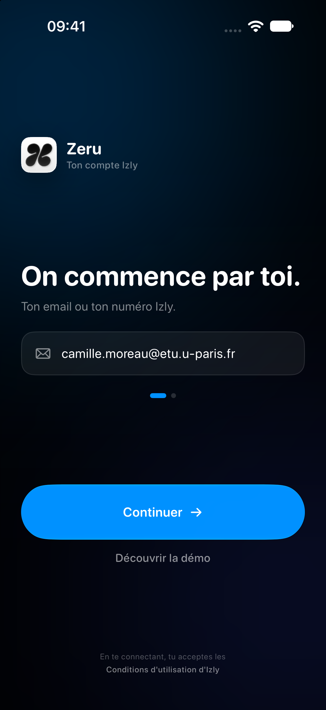
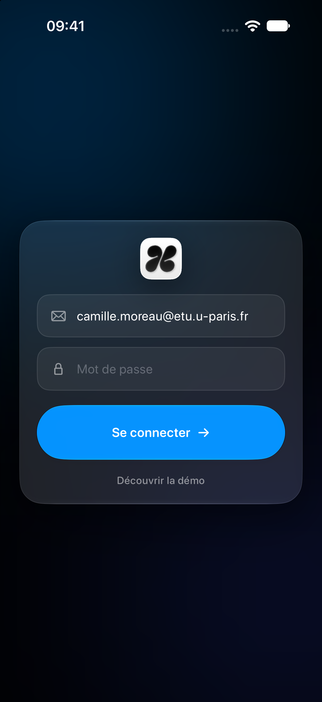
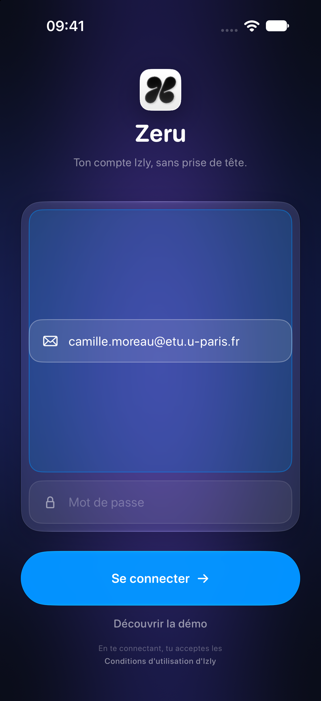
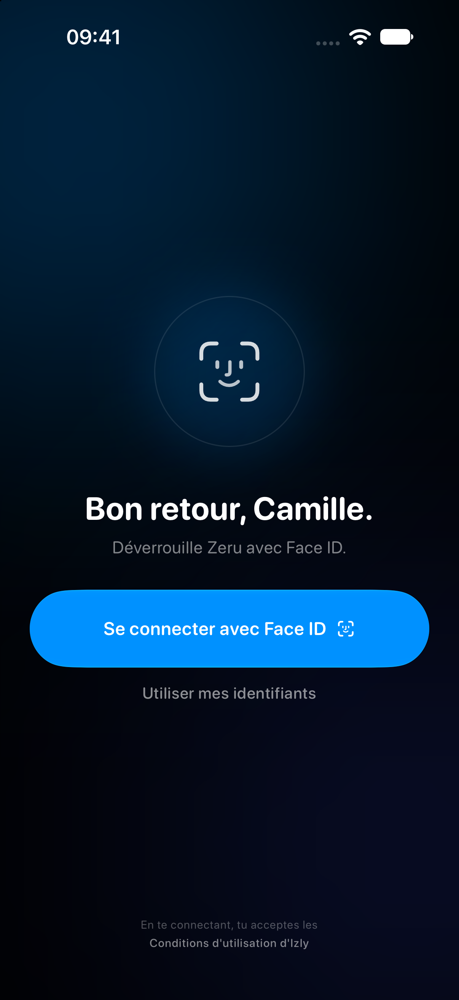

# Connexion — quatre directions natives iOS 27

> Quatre façons de réinventer l'écran de connexion de Zeru avec les animations
> que SwiftUI/iOS savent déjà faire. Aucun shader custom, aucun moteur tiers :
> uniquement Liquid Glass, matched geometry, symbol effects, phase/keyframe
> animators, mesh gradient et retours haptiques système.

Planche : [`00-planche.png`](00-planche.png) · Captures : iPhone 18 Pro, iOS 27.2.
Prototypes animés : `Zeru/Preview/LoginIdeas.swift` (DEBUG), à lancer avec
`-login-idea 1` … `-login-idea 4`, ou dans le canvas Xcode.

## Le point de départ

L'écran actuel est propre mais générique : fond noir, icône, carte de champs,
deux boutons capsule. Il n'exploite presque pas le langage iOS 26/27 :

- pas de Liquid Glass sur les champs,
- pas de mouvement continu,
- pas de symbol effects,
- pas de transition entre les étapes.

Les quatre directions ci-dessous gardent le même contenu (identifiant, mot de
passe, démo, conditions) et changent la mise en scène et le mouvement.

---

## Idée 1 · « Le guichet » — recommandée

**L'idée.** Une seule question à la fois, comme les feuilles d'authentification
d'Apple. D'abord « On commence par toi. » avec le champ identifiant ; au retour,
le champ glisse vers le haut, le titre s'interpole vers « Et ton mot de passe. »,
et le champ mot de passe monte du bas. Les points de progression s'étirent.

**Mise en page.** En-tête discret (icône + « Zeru »), grand titre contextuel,
un seul champ, deux points de progression, bouton principal, lien démo, footer.

**Animations natives.**

- transition du champ : `.transition(.asymmetric(insertion: .move(edge: .bottom), removal: .move(edge: .top)))` + `.spring(response: 0.45, dampingFraction: 0.85)` ;
- titre : `.contentTransition(.interpolate)` — le texte se morphose comme les titres d'iOS ;
- progression : capsules dont la largeur s'anime (`.spring`) ;
- bouton : `.buttonStyle(.glassProminent)` + `.contentTransition(.symbolEffect(.replace))` sur l'icône flèche/cadenas ;
- retour haptique : `.sensoryFeedback(.selection, trigger: step)`.

**Pourquoi c'est natif.** C'est exactement le rythme des feuilles Apple ID /
Wallet : une décision par écran, un ressort court, un titre qui se transforme.

**Pour / contre.** + très lisible, très rapide, aucune surcharge. − deux écrans
pour un login (mais c'est le prix de la clarté).

---

## Idée 2 · « La carte qui se déplie »

**L'idée.** L'icône de l'app s'ouvre en une carte de verre qui se déplie en 3D,
puis les champs apparaissent en décalé. On reprend le geste d'une carte Wallet
qui s'ouvre.

**Animations natives.**

- `.rotation3DEffect(.degrees(expanded ? 0 : -72), axis: (x: 1, y: 0, z: 0), anchor: .top, perspective: 0.6)` piloté par un `.spring(response: 0.8, dampingFraction: 0.78)` ;
- `.glassEffect(.regular, in: RoundedRectangle(...))` + rayon qui s'anime ;
- apparition des champs : `.transition(.opacity.combined(with: .offset(y: 14)))` ;
- icône : taille animée, liseré de verre.

**Pour / contre.** + mémorable, très « iOS 26 ». − un temps d'intro avant de
pouvoir saisir ; à réserver à la première ouverture.

---

## Idée 3 · « La lentille »

**L'idée.** Un mesh gradient qui respire en fond, et une lentille de verre dont
le focus glisse d'un champ à l'autre. C'est le langage « ambient » d'iOS 26/27
(Musique, Siri, App Store).

**Animations natives.**

- fond : `MeshGradient` animé par `TimelineView(.animation(minimumInterval: 1/30))` — les points dérivent lentement ;
- focus : capsule teintée qui glisse entre les champs via `matchedGeometryEffect` + `.spring` ;
- lentille : `.glassEffect(.regular, in: RoundedRectangle(...))` ;
- icône d'œil : `.contentTransition(.symbolEffect(.replace))`.

**Pour / contre.** + le plus « vivant », très identifiable. − le mesh gradient
consomme un peu de GPU ; à limiter quand l'app est en arrière-plan.

---

## Idée 4 · « L'empreinte »

**L'idée.** Face ID d'abord : le glyphe respire, le bouton principal déverrouille.
Les identifiants restent accessibles derrière un lien, dans une feuille de verre
qui monte du bas. Zeru stocke déjà le mot de passe dans le Keychain : Face ID
peut le déverrouiller et reconnecter sans rien taper.

**Animations natives.**

- glyphe : `.symbolEffect(.breathe, options: .repeating)` ;
- succès : `.contentTransition(.symbolEffect(.replace))` faceid → checkmark + `.sensoryFeedback(.success)` ;
- feuille : `.transition(.move(edge: .bottom).combined(with: .opacity))` + `.spring` ;
- bouton : `.glassProminent`.

**Pour / contre.** + le plus rapide au quotidien, et le plus sûr (le mot de
passe ne sort pas). − demande une première connexion classique pour stocker les
identifiants ; à proposer seulement quand le Keychain contient déjà un compte.

---

## Comparaison

| | Idée 1 | Idée 2 | Idée 3 | Idée 4 |
|---|---|---|---|---|
| Vitesse de saisie | ★★★ | ★★ | ★★★ | ★★★★ |
| Effet « waouh » | ★★ | ★★★★ | ★★★★ | ★★★ |
| Sobriété | ★★★★ | ★★ | ★★ | ★★★ |
| Coût GPU | faible | faible | moyen | faible |
| Quand l'utiliser | défaut | première ouverture | défaut « ambiant » | compte déjà connecté |

## Recommandation

- **Idée 1** comme écran par défaut : c'est la plus juste, la plus rapide et la
  plus proche des feuilles d'authentification d'Apple.
- **Idée 4** en complément : si le Keychain contient déjà un compte, ouvrir sur
  « Se connecter avec Face ID » et garder l'idée 1 derrière « Utiliser mes
  identifiants ».
- **Idée 2** pour l'onboarding / la première ouverture (le dépliage raconte
  l'app).
- **Idée 3** si tu veux une identité plus « ambient » ; à garder pour les
  grandes occasions.

## Détails d'implémentation

- Prototypes : `Zeru/Preview/LoginIdeas.swift` (DEBUG), quatre vues + `#Preview`.
- Lancement direct : `-login-idea 1` … `-login-idea 4`.
- Toutes les animations utilisent les APIs système : `.spring`, `.snappy`,
  `.glassEffect`, `.glassProminent`, `matchedGeometryEffect`, `symbolEffect`,
  `contentTransition`, `sensoryFeedback`, `MeshGradient`, `TimelineView`,
  `rotation3DEffect`. Aucun shader custom, aucun moteur d'animation tiers.
